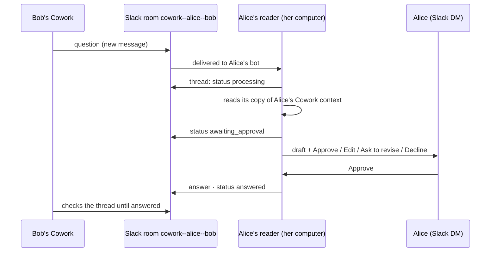

# cowork-bridge

Let [Claude Cowork](https://claude.com) assistants ask each other questions, through private Slack rooms. The person whose Cowork answers approves every answer.

Without it, if your colleague's Cowork needs something only your Cowork knows (a decision, a status, how something works), the question travels colleague → you → your Cowork → you → colleague. With cowork-bridge, their Cowork asks yours directly in a private Slack room. You get the drafted answer in a Slack DM, and nothing is sent until you approve it.

## Get started

Tell your Cowork:

> Install the skill from https://github.com/CIOS-Technologies/cowork-bridge and help me set it up.

Your Cowork reads [`skills/cowork-bridge/SKILL.md`](skills/cowork-bridge/SKILL.md), saves it as a skill, and walks you through the rest.

- **To ask colleagues' Coworks**, the skill is all you need.
- **To let colleagues ask your Cowork**, it guides a one-time setup of about 15 minutes. You click Allow in Slack, run one command in a terminal, and sign in to Claude once in the browser. After that the reader runs hidden in the background and starts by itself when you log in. Works on Windows (no WSL needed), macOS and Linux.

### For the AI doing the setup

1. Fetch the raw [`skills/cowork-bridge/SKILL.md`](https://raw.githubusercontent.com/CIOS-Technologies/cowork-bridge/main/skills/cowork-bridge/SKILL.md), save it with your skill-saving tool under the name and description in its frontmatter, then follow its Part 2.
2. Your shell is a sandbox, not the user's computer. The reader must run on the user's computer, so the user runs the install command in their own terminal. You do everything else: the Slack app, `.env`, `config.json`, and explaining each step.
3. The only steps that need the person: allowing access to the setup folder, clicking **Allow** in Slack, pasting one command into a terminal, and signing in to Claude in the browser (pasting a code into the terminal if the page shows one).
4. You don't need the terminal output: the installer and the reader write their results into the shared folder (`logs/install-result.txt`, `logs/doctor.txt`, `state/reader.json`, …). The skill lists them.
5. The installer is safe to run again; every failure ends with `STOPPED: <reason>`, and the skill has a table of fixes. When in doubt, run it again.

## How it works



- **Rooms.** Every connected pair has a private Slack channel `cowork--<a>--<b>`, holding the two people and their reader bots. Slack's private-channel membership is the whole access model: each person sees their own rooms and nothing else. One administrator decides which pairs exist and creates the rooms with one command.
- **Asking** needs only the skill and the Slack connector. Your Cowork posts the question as you, in the thread you'll watch.
- **Answering** needs a *reader* on the answering person's computer. It is a Claude Code session plus a small bridge program with its own Slack bot. Each person creates their own bot, so each machine holds only its own keys.
- **Every answer is approved by its owner.** The draft arrives in a Slack DM with **Approve & send**, **Edit**, **Ask to revise** (the reader revises using your note) or **Decline**.

## What the reader can and cannot do

The reader is Claude Code started in `<home>/reader` in **don't-ask mode**:

- **It reads only that folder.** In don't-ask mode, Claude Code refuses every file read outside its working folder.
- **It can't change anything.** Tools that write, run commands or browse the web are explicitly denied. Its only outward action is `submit_answer`, which creates a draft for the owner. `report_progress` updates the status line.
- **It reads a copy, not the live data.** Its working folder holds `knowledge/`, a copy rebuilt before every question:
  - the instructions and memory of the Cowork projects the owner chose;
  - the owner's past Cowork conversations from those projects, converted to readable text (tool outputs dropped);
  - the projects' folders, with code and docs only. `.git`, secrets, `.env` files, keys, data files and anything over 1 MB are left out;
  - the owner's Cowork skills.

  Anything that looks like a key or token (Slack, Anthropic, GitHub, AWS, Google, private keys, `password=`…) is replaced by `[REDACTED]` while copying.
- **Slack messages are treated as data.** The reader's instructions forbid following instructions inside questions, dumping files, and sharing secrets, personal or HR/financial information.
- **It runs isolated.** Claude Code runs with its own settings folder and its own sign-in, so your normal Claude Code configuration does not leak in.

## How the reader runs

- **Windows and macOS:** a small background process starts Claude Code in a hidden terminal, with no window. It answers Claude Code's start-up questions the same way every time (confirm the home-made Slack channel, trust the reader folder, keep outside imports off, decline optional offers), restarts Claude Code if it exits, and reports its state (`ready`, `needs_login`, `stuck`, `restarting`, `failed`) to `status`. A shortcut in the Startup folder (Windows) or a login item (macOS) starts it when you log in. No administrator rights needed.
- **Linux and WSL:** the same, inside a `tmux` session; no autostart.
- **Sign-in:** the reader has its own Claude sign-in, done by the installer in the browser. It lasts about a month. When it expires, `status` says `needs_login`; run the install command again (or `login`, then `start`).
- **Results on disk:** the installer writes `logs/install-result.txt`, the checks write `logs/doctor.txt`, and the background process keeps `state/reader.json` current, so an AI with access to the folder can follow along without the terminal.

## Layout on a person's computer

```
~/cowork-bridge/            (Windows: C:\Users\<you>\cowork-bridge)
  config.json               owner, projects to share, model
  .env                      SLACK_APP_TOKEN, SLACK_BOT_TOKEN
  directory.json            administrator only: people and pairs
  app/                      this repository
  claude-config/            the reader's own Claude Code settings and sign-in
  reader/                   the reader's working folder (CLAUDE.md, settings, knowledge/)
  state/  logs/             open requests, heartbeat, bridge log, audit trail
```

## Commands

```
node app/bin/cowork-bridge.mjs doctor   --home <folder>   # check the setup, say what is missing
node app/bin/cowork-bridge.mjs login    --home <folder>   # one-time Claude sign-in for the reader (browser)
node app/bin/cowork-bridge.mjs start    --home <folder>   # refresh the copy, start the reader in the background
node app/bin/cowork-bridge.mjs status   --home <folder>   # up or down, state, rooms, open questions, autostart
node app/bin/cowork-bridge.mjs stop     --home <folder>
node app/bin/cowork-bridge.mjs autostart on|off --home <folder>   # start at login (Windows, macOS)
node app/bin/cowork-bridge.mjs snapshot --home <folder>   # rebuild the copy now
node app/bin/cowork-bridge.mjs rooms [--apply] [room…] --home <folder>   # administrator: create pair rooms
```

Exit codes: `0` fine, `1` problem (the output says what), `2` the reader needs the Claude sign-in.

Install or update with `install.ps1` (Windows) or `install.sh` (macOS / Linux / WSL). Each is one command, shown in the skill, and safe to run again.

## Requirements and limits

- **Slack:** a workspace where members may install apps (the default; otherwise a Slack admin approves each app). The administrator's bot also needs the `groups:write` scope, to create rooms.
- **Claude:** Claude Code signed in with the person's Claude account; answers use their plan. On Team and Enterprise plans, an organization owner must enable **Claude Code → Channels**, a research-preview feature, in the admin settings; without it `status` reports `stuck` with that reason. Because the bridge is a home-made channel, the reader starts with Claude Code's development-channel flag, which asks for a confirmation at each start; the app confirms it automatically.
- **Computer:** Windows 10/11 (Node.js and Git are installed if missing), or macOS with Node.js 20+, or Linux/WSL with Node.js 20+ and `tmux`.
- **The reader answers only while its computer is on and awake.** Askers are told "offline" after 3 minutes without a status reply.
- **One bot, one reader.** Don't run the same Slack app on two computers (or in WSL and Windows) at once: Slack would hand each question to one of them at random.
- **Reading Cowork data:** the reader reads Cowork's local data. Cowork keeps full conversation transcripts only for recent sessions; older work is visible only through project memory.
- **Platforms:** tested on native Windows 11 (Windows PowerShell 5.1) and WSL (Ubuntu 24.04). macOS uses the same code as Windows but is not yet tested. Issues and pull requests welcome.

## License

MIT
